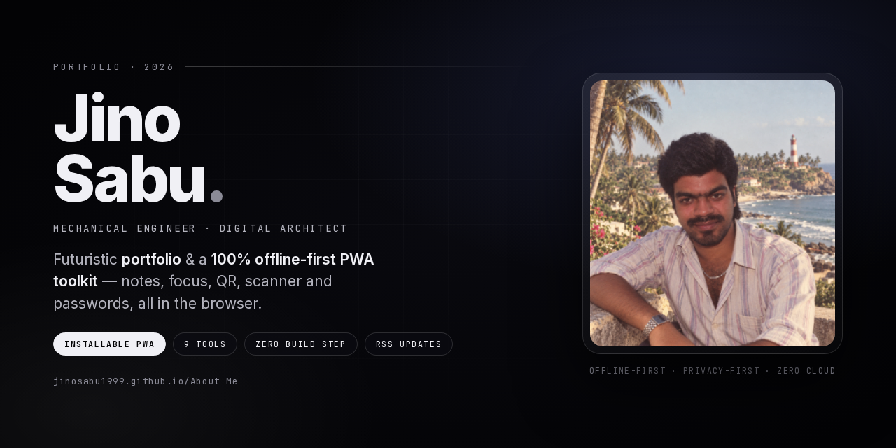

<div align="center">



# ⚡ Jino Sabu — Digital Architect & Productivity Hub

**A portfolio and a nine-tool, offline-first productivity suite — shipped as one HTML file.**

<p>
  <a href="https://jinosabu1999.github.io/About-Me/"><strong>🌐 Open the app</strong></a> &nbsp;·&nbsp;
  <a href="#-the-toolkit"><strong>🧰 The toolkit</strong></a> &nbsp;·&nbsp;
  <a href="#-install-it"><strong>📲 Install it</strong></a> &nbsp;·&nbsp;
</p>

<p>
  <a href="https://jinosabu1999.github.io/About-Me/"></a>
  <a href="#-install-it"></a>
  <a href="#-architecture"></a>
  <a href="LICENSE"></a>
  <a href="https://github.com/jinosabu1999/About-Me/stargazers"></a>
</p>

</div>

---

## 📑 Contents

- [✨ What this is](#-what-this-is)
- [🧰 The Toolkit](#-the-toolkit)
- [📲 Install it](#-install-it)
- [🔗 Hand the app something](#-hand-the-app-something)
- [⌨️ Keyboard](#-keyboard)
- [🏗️ Architecture](#-architecture)
- [🧪 Run it locally](#-run-it-locally)
- [🚀 Deploy](#-deploy)
- [🌐 The ecosystem](#-the-ecosystem)
- [🛍️ Creator store](#-creator-store)
- [🤝 Connect](#-connect)
- [📄 License](#-license)

---

## ✨ What this is

A portfolio that *is* the product. There is no CMS behind it, no API to call, no
build pipeline to run: `index.html` carries the entire experience — markup, styles,
logic, icons and fonts — and the browser is the only runtime it needs.

Every tool runs on-device. Notes, clips, counters, generated passwords and focus
logs never leave your browser, because there is nowhere for them to go.

### Why it's built this way

| | |
|---|---|
| 🧩 **One file** | The whole application is a single 1.2 MB `index.html`. No bundler, no framework, no `npm install` to read or run it. |
| 📴 **Offline-first** | A service worker precaches the shell, the fonts and the icon subsets, so the app boots and works with the network off. |
| 🔒 **Private by construction** | Your data lives in your browser's storage. There is no server to sync it to and no account to create. |
| 🔗 **OS-native** | Installed, the app registers as a **share target** and a **file handler** — other apps can hand it a link, a photo, a PDF or a `.csv`. |
| 🪟 **Title-bar aware** | On desktop it uses the `window-controls-overlay` display mode, so the site name lives in the OS title bar instead of under the window buttons. |

---

## 🧰 The Toolkit

Nine tools behind one launcher. Open **Tools** in the bottom dock.

| Tool | What it does | Stand-out feature |
|---|---|---|
| ⚡ **Focus Timer** | Deep-work countdown with presets (Pomodoro, Deep Work, Flow, Sprint) and custom intervals | Runs on a wall-clock timestamp, so it stays accurate through a reload, a backgrounded tab or a sleep |
| ✅ **Missions** | Kanban board with categories and due dates | Send anything from any tool straight into a task |
| ⏱️ **Stopwatch** | Lap timer with split deltas and tagged sessions | Export the full lap log to CSV |
| 🔑 **Passwords** | Generator with entropy controls and crack-time estimates | Detected secrets (API keys, JWTs, private keys) are masked and never reach the DOM |
| 📋 **Clipboard** | Smart history that classifies text, links, email and code | Pin it, filter it, send it to another tool, export it |
| 🔢 **Counters** | Tally habits, reps, inventory and milestones | Roll over on their own — daily, weekly or monthly, at the hour you choose |
| 📷 **Scanner** | Camera QR/barcode reader plus OCR for text in images | Reads whole batches: images *and* multi-page PDFs, with an action for each result |
| 🔲 **QR Studio** | QR codes for links, plain text, Wi-Fi and vCards | Download PNG, copy the image, or share it |
| 🛡️ **Data Vault** | Backup, restore and per-module privacy controls | One master JSON export and restore of everything |

Plus three companion sheets: the **Smart Scratchpad** (Markdown notes, slash
commands, PNG share cards), the **Appearance** sheet (themes, accents, accessibility)
and the **Share Card** studio.

### What a scan can do with the result

Open it · copy it · shorten a URL · compose a `mailto:` · dial a `tel:` · drop a
`geo:` on the map · turn a calendar event into a Mission with a due time · hand a
UPI link to your payment app · print a Wi-Fi join card for guests.

---

## 📲 Install it

The app is a standard, installable PWA — no store, no account.

| Platform | Steps |
|---|---|
| **iOS / iPadOS** | Open it in Safari → tap **Share** → **Add to Home Screen** |
| **Android** | Open it in Chrome → **⋮** menu → **Install app** / **Add to Home screen** |
| **Windows / macOS / Linux** | Open it in Chrome or Edge → the **install icon** in the address bar |
| **Any Chromium browser** | **⋮** menu → *Cast, save and share* → **Install page as app** |

Once installed you get the app icon, a standalone window without browser chrome,
offline support, and — on desktop — the native window controls.

**Home-screen shortcuts.** Long-press the installed icon to jump straight into a
tool: `?app=notes` · `?app=focus` · `?app=missions` · `?app=qr` · `?app=scan` ·
`?app=clip` · `?app=counters` · `?app=data` · `?app=toolkit`.

---

## 🔗 Hand the app something

The installed app registers itself with the operating system, so the things you
share or open in other apps land in the tool that owns them.

| You hand it… | It lands in… |
|---|---|
| Text or a link from the share sheet | **Clipboard** |
| An image or a PDF from the share sheet | **Scanner** batch queue |
| A `.md` file | A new **Scratchpad** note |
| A `.txt` file | The **Clipboard** |
| A `.csv` file | A set of **Counters** |
| A `.json` backup | The **Data Vault** (restored after you confirm) |

The hand-off is handled entirely by the service worker: it parks the payload,
redirects into the app, and the app reads it back exactly once.

---

---

## ⌨️ Keyboard

| Key | Action |
|---|---|
| <kbd>⌘</kbd> + <kbd>K</kbd> / <kbd>Ctrl</kbd> + <kbd>K</kbd> | Open the command palette |
| <kbd>↑</kbd> <kbd>↓</kbd> | Move through results |
| <kbd>Enter</kbd> | Open the highlighted result |
| <kbd>Esc</kbd> | Close the palette or any sheet |

The palette searches **commands, notes, missions and clipboard history** in one
place, and it doubles as a calculator — type `24 * 7` for the answer, or
`10 kg to lbs` for a conversion. Both results are one click from being copied.

---

## 🏗️ Architecture

### What's in the repository

| Path | Purpose |
|---|---|
| `index.html` | The entire application — markup, styles, logic and the inline icon/font subsets |
| `sw.js` | Service worker: versioned precache, caching strategy and the share-target handler |
| `manifest.json` | Web App Manifest — icons, shortcuts, `share_target`, `file_handlers`, `display_override` |
| `feeds/` | JSON snapshots of the GitHub and Gumroad data, refreshed by CI |
| `fonts/` | Self-hosted, subset Inter + JetBrains Mono and the Font Awesome glyphs actually used |
| `icons/` | The full PWA icon suite, including maskable Android icons |
| `.github/workflows/` | The two automation workflows (below) |
| `browserconfig.xml`, `robots.txt`, `sitemap.xml` | Windows tile config, crawler policy and sitemap |

### How caching works

| Request | Strategy |
|---|---|
| `index.html` | **Network-first** with a 3-second timeout, falling back to the cached shell — a deploy is picked up immediately, and offline still works |
| `feeds/*.json` | **Network-first**, cached copy as the fallback |

| Old cache buckets | Purged on `activate`, so a new `CACHE_VERSION` always means a clean slate |

### Where your data lives

`localStorage` is the primary store (`jsSmartNotes`, `jsTasks`, `jsClipboard`,
`jsCounters`, `jsPasswords`, `jsFocusSessions`, `jsStopwatchSessions`,
`jsScanHistory`, `jsHabits`, `jsNoteFolders`), with an **IndexedDB mirror**
(`jino-portfolio-store`) used to recover data if local storage is ever cleared.
The Data Vault can export and restore all of it as one master JSON file.

### Dependencies

The application ships with **no runtime dependencies and no build step**. Five
optional libraries are lazy-loaded from a CDN the first time you use the feature
that needs them, and are cached by the service worker afterwards:
`jsQR` (QR decoding), `Tesseract.js` (OCR), `pdf.js` (PDF scanning), `Chart.js`
(charts) and `Mermaid` (diagrams).

---

## 🧪 Run it locally

There is no build step, so any static server works:

```bash
git clone https://github.com/jinosabu1999/About-Me.git
cd About-Me

python3 -m http.server 8080     # or: npx serve .
```

Open <http://localhost:8080>. The app registers `sw.js` itself, so the service
worker, the manifest and the install prompt all work on `localhost` exactly as
they do in production.

> Use `http://` or `https://` rather than opening the file directly — service
> workers and the manifest are blocked on `file://`.

---

## 🚀 Deploy

This repository deploys to **GitHub Pages** straight from `main` — no Pages
actions, no build configuration.

**Settings → Pages → Build and deployment → Deploy from a branch** (`main`, `/`).

Two workflows keep the site honest:

| Workflow | Runs when | What it does |
|---|---|---|
| **Sync sw version** | `index.html` or `sw.js` is pushed | Writes `CACHE_VERSION` in `sw.js` to match `SITE_VERSION` in `index.html`, so the offline cache can never go stale |
| **Sync feeds** | every 6 hours, or on demand | Refreshes `feeds/repos.json` and `feeds/store.json` from the GitHub and Gumroad APIs, so the browser never hits a rate limit |

### Shipping a release

1. Add your entry to the **top** of `window.SITE_CHANGELOG_FALLBACK` in `index.html`.
2. Bump `window.SITE_VERSION` in the same file.
3. Push.

The workflow handles the rest: the cache version follows the site version.

---

## 🌐 The ecosystem

21 public repositories, all deployed on GitHub Pages.

**Selected work**

| Project | What it is | Live |
|---|---|---|
| **Lumière** | A couture-grade image studio that resizes, crops, retouches and exports photos with pixel precision — entirely on your device | [Open](https://jinosabu1999.github.io/Lumiere/) · [Source](https://github.com/jinosabu1999/Lumiere) |
| **SonicForge** | A complete audio cutter and music editor that trims, cleans and exports sound privately in your browser | [Open](https://jinosabu1999.github.io/SonicForge/) · [Source](https://github.com/jinosabu1999/SonicForge) |
| **Carroms Pool Game** | A browser-based carroms pool game — classic carroms meets pool physics | [Open](https://jinosabu1999.github.io/Carroms-Pool/) · [Source](https://github.com/jinosabu1999/Carroms-Pool) |

**Everything else**

| Repository | What it is |
|---|---|
| [Snake-Game](https://github.com/jinosabu1999/Snake-Game) | Snake game |
| [Lumiere](https://github.com/jinosabu1999/Lumiere) | Image editor and image resizer |
| [SonicForge](https://github.com/jinosabu1999/SonicForge) | Audio editor, cutter and music editor |
| [Monadio](https://github.com/jinosabu1999/Monadio) | TypeScript project |
| [To-Do-List](https://github.com/jinosabu1999/To-Do-List) | Task list app |
| [Notes-App](https://github.com/jinosabu1999/Notes-App) | Notes app |
| [Calendar](https://github.com/jinosabu1999/Calendar) | Calendar |
| [Periodic-Table](https://github.com/jinosabu1999/Periodic-Table) | Interactive periodic table |
| [Carroms-Pool](https://github.com/jinosabu1999/Carroms-Pool) | Carroms pool game |
| [Tic-Tac-Toe](https://github.com/jinosabu1999/Tic-Tac-Toe) | Tic-tac-toe |
| [Flappy-Bird-Game](https://github.com/jinosabu1999/Flappy-Bird-Game) | Flappy Bird |
| [Color-Palette-Generator](https://github.com/jinosabu1999/Color-Palette-Generator) | Colour palette generator |
| [Text-To-Speech](https://github.com/jinosabu1999/Text-To-Speech) | Text to speech |
| [Speech-To-Text](https://github.com/jinosabu1999/Speech-To-Text) | Speech to text |
| [QR-Code-Generator](https://github.com/jinosabu1999/QR-Code-Generator) | QR code generator |
| [Password-Generator](https://github.com/jinosabu1999/Password-Generator) | Password generator |
| [Calculator](https://github.com/jinosabu1999/Calculator) | Calculator |
| [Countdown-Timer](https://github.com/jinosabu1999/Countdown-Timer) | Countdown timer |
| [Digital-Clock](https://github.com/jinosabu1999/Digital-Clock) | Digital clock |

---

## 🛍️ Creator store

Digital products, priced in ₹, sold through Gumroad and synced live on the site.

| Product | Price |
|---|---|
| [FITFLOW — Complete Workout & Progress System](https://jinosabu1999.gumroad.com/l/fitflow) | ₹99 |
| [One Piece Anime 4K wallpaper bundle](https://jinosabu1999.gumroad.com/l/One-piece-wallpaper-pack) | ₹88 |
| [Reset Your Life in 30 Days](https://jinosabu1999.gumroad.com/l/Reset-Your-Life) | ₹199 |

---

## 🤝 Connect

<p>
  <a href="https://github.com/jinosabu1999"></a>
  <a href="https://www.x.com/jinosabu1999"></a>
  <a href="https://www.instagram.com/jinosabu1999"></a>
  <a href="https://www.youtube.com/@JinoSabu1999"></a>
  <a href="https://ko-fi.com/jinosabu1999"></a>
  <a href="https://paypal.me/jinosabu"></a>
</p>

Found something useful? A ⭐ on this repository helps more than you think.

---

## 📄 License

MIT — see [LICENSE](LICENSE).

<p align="center">
  <sub>Designed and engineered by <b>Jino Sabu</b> · Mechanical Engineer &amp; Digital Architect · Kerala, India</sub>
</p>
